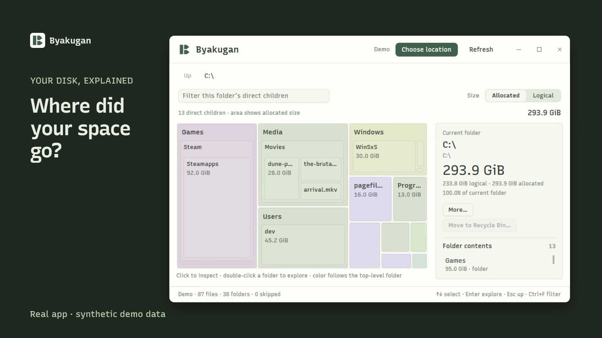
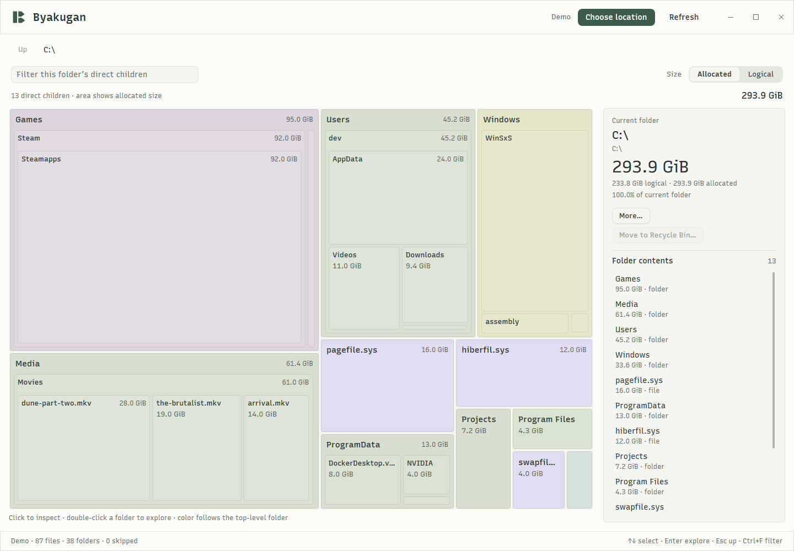
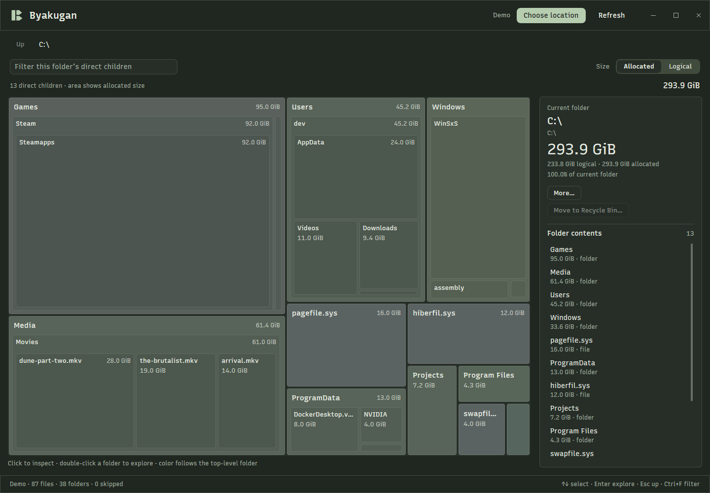

# Byakugan

**See where your space goes.**

A native Windows disk analyzer built with Zig and [nanoui](https://github.com/justrach/nanoui).
Scan a folder or an NTFS drive, explore a nested treemap, and review file or folder
cleanup without losing your place.

[](https://github.com/lsj5031/byakugan/raw/refs/heads/main/docs/media/byakugan-25s.mp4)

**[Watch the 25-second demo](https://github.com/lsj5031/byakugan/raw/refs/heads/main/docs/media/byakugan-25s.mp4)** ·
[Build from source](#build-from-source) · [Controls](#controls) · [How sizes are counted](#how-sizes-are-counted)

The video uses actual app captures, labelled synthetic scan data, and a disposable
cleanup fixture. No files were recycled during filming. Made with
[brag](https://github.com/latent-spaces/brag) and Hyperframes; [source and credits](docs/demo/README.md).

## Find the space, then decide what to do

- **Choose the scope.** Walk a folder without elevation, or read the NTFS Master
  File Table for a whole-drive view. Nothing scans automatically on ordinary launch.
- **Explore visually.** Rectangle area follows allocated or logical size. Click
  to inspect; enter a folder to see its children. Breadcrumbs keep your location clear.
- **Act on files and folders.** Use the inspector or right-click menu to show an
  item in Explorer, copy its path, or open a recycle confirmation.
- **Keep your bearings.** Refresh preserves the current folder, filter and inspector
  scroll. A failed or cancelled replacement scan retains the previous result.
- **Use the keyboard.** Visible focus, keyboard-accessible controls, and immediate
  navigation. Light/dark appearance and Windows reduced-motion preferences are supported.

| Light | Dark |
| --- | --- |
|  |  |

Screenshots use the built-in synthetic demo, not a scan of a user's files.

## Windows preview

The portable x64 package is attached to the [preview release](https://github.com/lsj5031/byakugan/releases).
Extract the complete ZIP and run `byakugan.exe`; `byakugan-cli.exe` is included.
No installer or Zig toolchain is needed. Compare `Get-FileHash <zip> -Algorithm
SHA256` with the accompanying `.zip.sha256` file before running it.

This is an **unsigned preview**, tested on Windows 11 x64. Windows may display
an unknown-publisher or SmartScreen warning. Real successful recycling, partial
failures and alternate-account privilege transitions still need manual validation;
automated checks do not establish those outcomes. See [release checks and limitations](docs/releasing.md).

## Build from source

Windows x64, Git, and a Zig **0.17** toolchain are required; this revision was
tested with Zig **0.17.1**. GUI and CLI binaries are built together.

For a distributable build, use the [release packager](docs/releasing.md): it runs
the suites with ReleaseSafe and a baseline x64 CPU, strips debug symbols, checks
the packaged binaries, and includes checksums, provenance and dependency notices.

The current Windows integration needs a small nanoui compatibility patch for
folder selection and reduced motion. Use the pinned revision below, with both
repositories beside each other. The patch is included so the build does not
depend on unpublished files in a developer's checkout.

Run in a new parent directory:

```powershell
git clone https://github.com/lsj5031/byakugan.git
git clone https://github.com/lsj5031/nanoui.git
git -C nanoui switch --detach 7d4424b1046f8bbab365b42f61d00f1934d4dcc8
git -C nanoui apply --check ../byakugan/tools/nanoui-windows.patch
git -C nanoui apply ../byakugan/tools/nanoui-windows.patch
Set-Location byakugan
zig build -j1
zig build test -j1
```

Use a fresh nanoui checkout for these commands; do not reapply the patch to an
already patched or independently modified checkout. See [dependency notes](tools/nanoui-windows.md).

Launch the chooser:

```powershell
& .\zig-out\bin\byakugan.exe
```

Or start with a folder or synthetic demo:

```powershell
& .\zig-out\bin\byakugan.exe "--folder=$env:USERPROFILE\Downloads"
& .\zig-out\bin\byakugan.exe --demo
```

## Controls

| Action | Mouse or keyboard |
| --- | --- |
| Choose another location | **Choose location**; selecting a drive still requires **Scan drive** |
| Inspect an item | Click a tile or inspector row; ↑ / ↓ selects entries |
| Enter a folder | Double-click, **Explore folder**, or Enter while browsing |
| Go up | **Up**, a breadcrumb, or Escape while browsing |
| Filter immediate children | Ctrl+F; **Clear** removes the filter |
| Change the size measure | **Allocated** / **Logical** |
| Refresh this scan | **Refresh** or F5 |
| File/folder actions | Right-click or **More…** |
| Review recycling | **Move to Recycle Bin…** or Delete while browsing |
| Navigate controls | Tab / Shift+Tab, then Enter or Space |

The filter matches names of the current folder's **direct children**, not every
descendant. Matching folders keep their nested maps. **Other** opens entries too
numerous to draw separately; zero-byte entries remain available in the inspector.

The window supports 900×600 and larger sizes. Drag empty header space to move it,
double-click to maximize, or resize from its edges.

## Administrator scans and normal reopening

Full NTFS scans require administrator access. Choose **Restart as administrator**
after an access-denied result, or launch an explicit volume scan:

```powershell
Start-Process .\zig-out\bin\byakugan.exe -Verb RunAs -ArgumentList '--volume=C:'
```

The original window closes only after the child verifies its elevated token and
reads the selected drive. Cancelling UAC or failing that check leaves the original
window available. An already-elevated access failure offers another location
instead of repeatedly asking for elevation.

Administrator sessions can use cleanup actions. **More… → Reopen normally** is
optional: Explorer launches a window under the desktop account, scans the containing
folder and selects the same item. The administrator window stays open. If a normal
desktop shell is unavailable, reopening reports an error without an elevated fallback.

## Cleanup behavior

Recycling always asks for confirmation, with **Cancel** focused initially. The
worker rechecks the captured item's identity and asks Windows for recycle-only
deletion. It has **no permanent-delete fallback**. Scan roots, protected paths,
reparse points, non-fixed drives, stale results and changed identities are rejected.

Progress and outcomes stay inline. After an attempted operation the app refreshes
the scan; uncertain outcomes explain that partial changes may have occurred.
Confirmed success offers **Open Recycle Bin**. Space stays used until the bin is
emptied, and remaining hard links can keep file data allocated.

The scan is a snapshot: contents can change before cleanup. Identity checks reduce
replacement mistakes but cannot eliminate every last-instant filesystem race.

## How sizes are counted

**Logical** is content size. **Allocated** is disk allocation; sparse holes have
no physical allocation. NTFS scans count mapped clusters from each nonresident
attribute extent, including sparse streams that lack the usual sparse flag.
Reserved filesystem records appear together under **System metadata** and remain
included in totals.

Folder scans walk accessible entries, skip inaccessible entries and reparse points,
and report skipped counts. They are a partial view, not a complete volume accounting.
Allocated totals and Windows' used-space figure can differ because of filesystem
metadata, hard links, inaccessible data and changes during scanning. This is an
exploration tool, not a filesystem repair utility or a live search index.

## CLI, tests and diagnostics

```powershell
& .\zig-out\bin\byakugan-cli.exe --folder "$env:USERPROFILE\Downloads" --allocated --top 20 --no-progress
zig build test -j1
```

The tests cover parsing/accounting, logging, offscreen interactions and invisible
native window chrome. Captures are written to `artifacts/`. They do not drive the
real desktop or trigger UAC; passing them is not proof of a successful live recycle.

Logs go to `%LOCALAPPDATA%\byakugan\byakugan.log`, with TEMP fallback and one rotated
archive. Each file is capped at 1 MiB of logger output. Events include timestamps,
process/thread IDs and aggregate scan counts, not file inventories or folder paths.
Set `BYAKUGAN_LOG` to a destination or `off`. See [logging details](docs/logging.md).

## Credits

The exploration layout is inspired by [DiskTree](https://github.com/tobi/disktree).
Typography is [Recursive Sans Linear](https://www.recursive.design/), bundled under
the [SIL Open Font License](src/fonts/LICENSE.txt). The Partition mark is the app's
shared header, window and executable identity. Demo music: Sascha Ende,
[ende.app](https://ende.app/en), CC BY 4.0; [full media credits](docs/demo/README.md).

See [third-party notices](THIRD_PARTY_NOTICES.md) for dependency and adapted-code
licenses. A license for Byakugan's original source is pending owner approval;
the third-party notices do not grant a blanket license to this repository.
